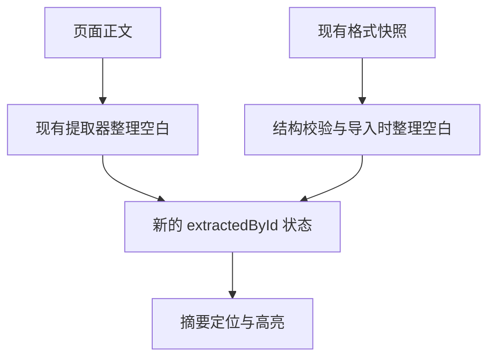

# Search Local Optimizations - Plan

## Goal Capsule

- **目标：** 改善长文搜索响应及首次 Lua 索引准备的等待，同时降低日常查询的重复计算。
- **方法：** 正文摘要复用整理后的文本、Lua 全量重建跳过无关页面、单次查询复用分词结果，分别见 KTD1–KTD3。
- **范围依据：** 本次请求将三项局部优化一并纳入计划。当前交付是计划草案；实施、提交和发布是后续动作。
- **交付形态：** 三个可独立验证的改动单元，集成为一个候选。若后续需要 PR，默认一个 PR；独立单元不自动等于三个 PR。
- **停止条件：** 搜索结果不等价，或必须改变分词语义、持久化格式才能实现时，先记录证据并调整方案，不扩大本轮改动。
- **完成与发布：** 实施者负责结果等价、性能测量和本地质量检查；用户保留提交、推送及发布决定。

## Product Contract

### Summary

在现有搜索架构内消除三类重复工作，保持查询及索引更新行为。优先完成正文摘要优化，其次 Lua 全量重建筛选，最后合并查询分词复用。

### Problem Frame

0.3.9 已提供正文归一化缓存、标题候选缓存和重复发布调度去重，但当前源码仍在摘要查询时重复整理全文空白，在 Lua 全量重建时为无关页面分批让出主线程，并在一次搜索内重复执行查询分词。

核查基线为本地 `0a29eca`、源码版本 0.3.11。2026-11-06 的隔离 Node 探针使用生产模块和 bootstrap analyzer，得到下列调用计数；这不是浏览器性能基准，也不是候选优化后的结果。

| 场景 | 当前观察 | 本轮要消除的工作 |
| --- | --- | --- |
| 20 篇合成长文的热查询 | 20 次全文空白整理，扫描 1,950,040 个 UTF-16 单元 | 查询阶段的空白整理 |
| 2,000 篇普通页面与 20 篇 Lua 模块，全量重建 | 只索引 20 篇，调用 yield 1,010 次 | 非 Lua 页面造成的空批次 |
| 标题、正文、Lua 单次查询 | 普通查询分词 2 次；正文 AND→OR 回退 3 次 | 同一次搜索的重复分词 |

### Requirements

**行为与兼容性**

- R1. 固定语料和查询下，候选与基线的结果逐字段相同，包括 ID、顺序、得分、摘要、符号匹配、重定向信息及高亮坐标。
- R2. 继续接受现有合法快照；保留快照验证、generation 防护和重建期间更新重放。
- R3. 增量更新继续正确处理新增、更新、删除、重定向及内容模型变化。

**优化范围**

- R4. 正文摘要查询直接消费已整理的文本，保持原文命中优先及归一化 fallback 行为。
- R5. Lua 全量重建的工作批次只处理符合现有条件的页面，保留真实索引工作的协作式调度。
- R6. 标题、正文、Lua 每次非空有效查询只生成一次查询 tokens，AND 和 OR 尝试共用该结果。

### Scope Boundaries

不更换搜索引擎、增加依赖、修改 Analyzer 语义、改变快照结构或兼容键，也不增加长期文本缓存。现有归一化缓存的预算和失效规则保持不变。

本轮不调整输入防抖、全局调度器、同步频率或数据库读取范围。Worker、快照拆分和全局时间片调度需要另行证明收益，不能作为这三项的附带改造。应用升版和真实站点安装不包含在本地实施验收中。

### Success Criteria

确定性目标分别由 U1–U3 定义；性能是否改善按 Verification Contract 的配对测量判定。最终报告同时披露查询、重建和快照恢复成本，不将调用次数降幅当成用户等待时间降幅。

## Planning Contract

### Key Technical Decisions

- KTD1. **把空白整理放在正文文本进入索引状态的边界。** `extractWikitext` 和 BSON 提取器已经整理空白，沿用其产物；快照导入则在写入新的 `extractedById` 前统一整理一次。摘要读取直接使用该文本。保留原有快照结构校验，并且不修改传入的 payload。该选择落实 R2、R4，不新增一份全文 Map。
- KTD2. **只收窄 Lua 全量重建的批次输入。** 筛选采用 `toDocument` 现有的廉价条件：未删除、非重定向、内容模型为 Scribunto、content 为字符串。筛选在 `ConcurrentRebuildLifecycle.rebuildAsync` 的构建回调内进行，不提前解析 Lua；实际索引仍按现有 batchSize 分批。`update`、`updateAsync` 和 pending update 重放保持完整输入，落实 R3、R5。
- KTD3. **复用调用内 tokens，不建立跨查询缓存。** 三类索引使用本次已经计算的 tokens 供 MiniSearch 查询 tokenize 回调返回；AND→OR 不重复计算。保留现有 normalize、fuzzy、boost、filter、排序和 limit。按当前依赖实现，MiniSearch 对返回 tokens 做映射处理；实施时仍须核对锁定版本及结果等价，落实 R1、R6。
- KTD4. **以固定生产源码基线作比较。** 实施前重新核对 HEAD、锁文件和现有改动；保留原有五个 staged 文档/忽略规则差异的内容及暂存状态。基线与候选在隔离环境中使用同一测试驱动及合成数据，历史性能报告不改写。

### High-Level Technical Design

正文文本由以下两个入口汇入同一状态，查询时不再重复整理空白；繁简转换和 NFKC 仍按既有 fallback 缓存策略执行。

### Sequencing

U1 与 U2 没有功能依赖。U3 同时修改它们涉及的索引文件，因此建议顺序执行 U1 → U2 → U3，避免相互覆盖。每个单元携带对应测试和测量增量，最后验证组合候选；不为测量框架单独建立交付单元。

### Evidence

实现依据为 `src/search/content-index.ts`、`src/content/extract-wikitext.ts`、`src/content/extract-content.ts`、`src/search/lua-module-index.ts`、`src/search/title-index.ts`、`src/search/rebuild-lifecycle.ts`，以及锁定安装的 MiniSearch 查询实现。

历史方法参考 `docs/performance/0.3.9.md`；其旧数值只作为历史。项目记忆《Key decisions and rationale》（2026-10-06 更新）提供了按需性能专项及既有缓存决策的线索，已用当前源码与文档核对。

## Implementation Units

### U1. Reuse compact snippet text

**目标与要求：** 移除摘要查询的重复全文空白整理，满足 R1、R2、R4。无前置单元。

**文件：** `src/search/content-index.ts`；`tests/search/content-search.test.ts`；必要时补充 `tests/search/index-snapshot.test.ts`；测量扩展放入 `scripts/benchmark-local-search.mjs` 和 `scripts/benchmark-local-search-browser.ts` 的既有正文场景。

**方案：** 按 KTD1 处理导入边界，复用现有提取器和缓存生命周期。先保留代表性摘要的基线结果，再调整查询路径；不重新设计摘取、定位或高亮算法。

**测试场景：**

1. wikitext 与 BSON 含换行、制表符、连续空格及首尾空白时，提取、搜索摘要和高亮与基线相同。
2. 现有格式快照含合法但空白未压缩的字符串时，导入后原文、大小写不敏感及 fallback 摘要均与基线相同；原 payload 不被修改。
3. 复用现有繁简、NFKC、单字、多词、长文尾部、超预算和 LRU 测试；仅补缺口，不复制整套断言。
4. 更新、删除、异步重建和快照导入期间到达的新正文不会被旧摘要覆盖；错误快照继续走现有拒绝/重建路径。

**验证：** 单元测试证明文本及缓存行为，快照测试证明恢复路径；两者不证明浏览器耗时。确定性门槛是准备完成后，冷/热摘要查询的全文空白整理均为 0 次。旧快照的一次性整理成本单独记入恢复阶段，不移出计时后宣称无成本。

### U2. Filter Lua full rebuild inputs

**目标与要求：** 排除无关页面的空批次，满足 R1–R3、R5。无前置单元。

**文件：** `src/search/lua-module-index.ts`；`tests/search/lua-search.test.ts`；必要时补充 `tests/search/index-snapshot.test.ts`；Lua 重建配对场景扩展 `scripts/benchmark-local-search.mjs` 与 `scripts/benchmark-local-search-browser.ts`。

**方案：** 按 KTD2 在全量重建中复用同一资格判定，避免与 `toDocument` 条件漂移。保持旧状态可查、候选完成后替换及 pending updates 重放的既有模式。数据库 pages 输入按主键唯一；不把一次重建的筛选结果缓存到后续增量更新。

**测试场景：**

1. 2,000 篇非 Lua 页面加 20 篇有符号的 Lua 模块，默认两页一批，索引与查询结果同基线，yield 为 10 次。
2. 空输入、全非 Lua、内容模型大小写、空字符串内容、无符号 Lua、删除及重定向页面均保持原有收录结果；不为普通页面产生工作批次。
3. 在有效批次让出时更新、删除、Lua→非 Lua、非 Lua→Lua，最终状态包含最新事实；全部被筛掉的初始输入也覆盖同轮并发更新。
4. 保留实际 Lua 批次的 yield，以及较新重建优先的 lifecycle 行为；快照不可用而回退到全量重建时结果一致。

**验证：** 调度计数用注入的 scheduler 测量；现有 lifecycle 和快照集成测试覆盖安装/重放，但不代表浏览器时间。混合语料满足 1,010→10 的目标，全 Lua 语料没有丢失协作式让出。单篇大模块的解析成本仍存在。

### U3. Reuse query tokens within each search

**目标与要求：** 减少同一次查询的重复分词，满足 R1、R6。功能上独立；文件修改在 U1、U2 之后整合。

**文件：** `src/search/title-index.ts`、`src/search/content-index.ts`、`src/search/lua-module-index.ts`；`tests/search/title-index.test.ts`、`tests/search/content-search.test.ts`、`tests/search/lua-search.test.ts`；调用计数扩展 `scripts/benchmark-local-search.mjs`。

**方案：** 按 KTD3 在三个 search 方法内复用局部 tokens。没有跨索引公共缓存或新的 Analyzer 接口。标题的 Combined/线性兜底调用链保持原样。

**测试场景：**

1. 标题、正文、Lua 的普通有效查询，每次 `queryTokens` 调用一次；AND 未命中且 OR 有结果时仍为一次。
2. 繁简、NFKC、大小写、驼峰、中文单字和多词查询逐字段等价；标题短 CJK 不触发 OR 的限制保留。
3. 连续查询不同词不会复用前一次 tokens；空白或无有效 token 的输入保持原有空结果。
4. namespace、limit、fuzzy、标题 boost、Lua matchRank 及 Combined 标题兜底保持既有排序；分别用真实 Jieba 和 bootstrap 分词器验证。

**验证：** 分词调用数为普通查询 2→1、OR 回退 3→1；测试用完整结果及正常输入覆盖语义，计数探针只证明减少工作，不代替等价检查。

## Verification Contract

### Correctness and measurement

1. 每单元使用对应测试文件做定向回归，已有覆盖直接复用。全套 `npm run check` 在组合候选完成后运行，覆盖 lint、格式、测试、类型与构建；无需因只修订本计划而运行。
2. 使用既有离线生产模块加载、合成语料和结果签名方法，保存基线与候选完整结果。计数插桩与耗时采样分开；不把墙钟阈值加入普通单测。
3. 三轮配对测量，每轮热查询热身至少 5 次、采样至少 30 次，报告各轮 p50/p95。冷查询单独报告单次观测；Lua 重建和快照恢复每样本使用新索引状态，报告原始耗时和三轮中位趋势。基线和候选同一依赖、分词器、语料与查询，测量时不并行构建/测试。
4. U1 测原文直命中、大小写不敏感、归一化 fallback、多词、长文尾部及短文对照，同时测快照导入和恢复后首查。U2 测混合语料、全 Lua、全非 Lua以及冷重建路径，不把快照命中路径计为筛选收益。U3 测 AND 和 OR，覆盖三类索引。
5. 隔离浏览器 fixture 使用生产模块和合成库，核对候选版本/marker，测正文查询与 Lua 准备；不连接真实 Wiki 数据库。浏览器不可用时，保留已完成的 Node 结果并明确浏览器验收待补。

### Acceptance gates

- 三个单元的确定性目标全部满足，完整结果签名一致，组合候选的本地质量检查通过。
- U1 长文热查询和 U2 混合语料冷重建：三轮配对中位耗时应低于基线；若只减少计数而时间未改善或结果噪声过大，报告“收益未证实”，不得宣布性能目标完成。U3 以分词计数下降且无可辨识时间回退为门槛，不要求短查询出现固定百分比提速。
- 对照查询、全 Lua 重建、快照恢复及恢复后首查若连续三轮出现超过 20% 且绝对值超过 1 ms 的中位耗时回退，应定位原因并修正或退回对应单元，再验收。这是本次专项的复核门槛，不是永久 CI 规则。
- 快照恢复有新增空白整理成本时，报告其与热查询收益的取舍；超过上述回退门槛不能仅凭热查询变快接受。

### Evidence and workspace

新测量另存日期化报告，包含源码提交/差异身份、工具版本、分词器、语料、原始样本与限制；不覆盖 `docs/performance/0.3.9.md`。复用现有浏览器驱动，仅在增加场景确有需要时修改 `scripts/benchmark-local-search-browser.playwright.js`，不新建通用框架。

实施与结束时按 KTD4 核对原有暂存内容；本次计划及后续性能证据不自动加入暂存区。只清理本次创建的临时资源。

## Definition of Done

- U1–U3 分别达到其验证目标，组合候选满足 Verification Contract。
- 交付报告区分确定性计数、Node 耗时、浏览器测量和未覆盖边界，明确仍存在的首次长文归一化及单篇 Lua 解析成本。
- 没有遗留废弃实验实现、生产路径计时探针或额外全文缓存。
- 原有 staged 改动保持完整；最终说明实施、提交、推送和发布各自的实际状态。
